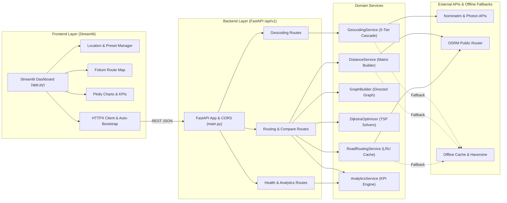
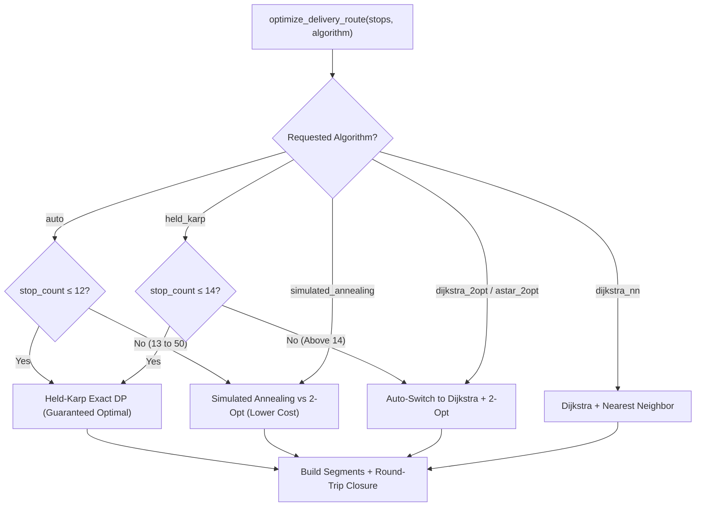
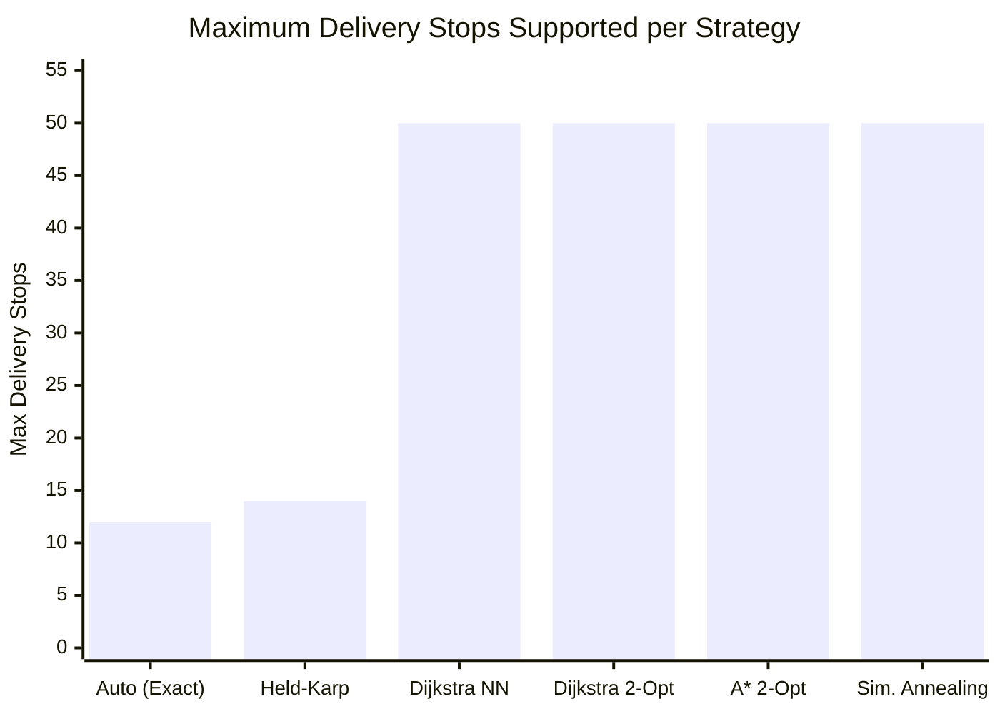
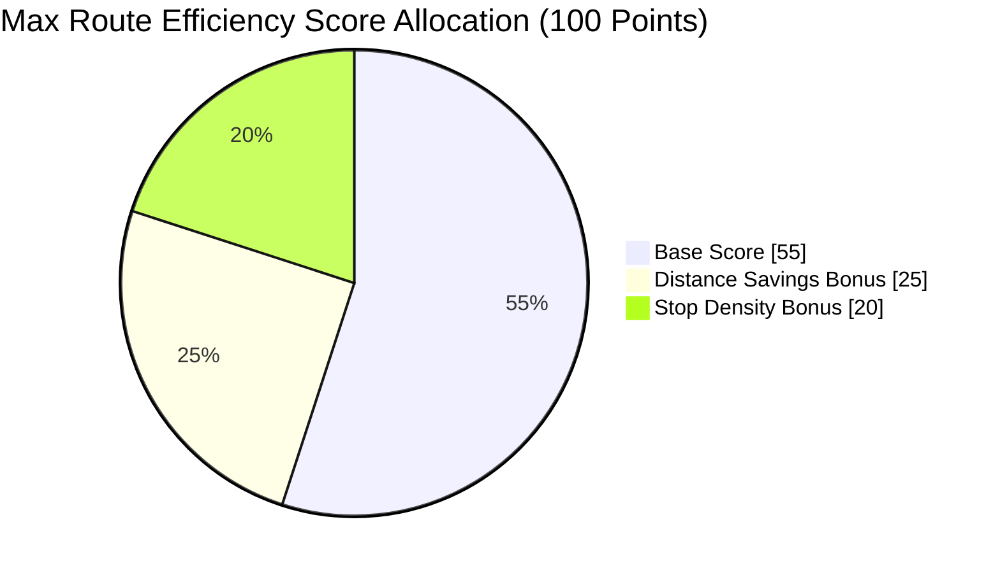

# Logistics Delivery Route Optimizer


A full-stack logistics route optimization platform combining a **FastAPI** REST backend and an interactive **Streamlit** dashboard. It pairs shortest-path graph search (**Dijkstra**, **A\***) and TSP solvers (**Held-Karp Exact DP**, **2-Opt**, **Simulated Annealing**) with live **OSRM road network routing** and **Haversine** fallbacks to compute optimal delivery sequences, interactive maps, algorithm benchmarks, and fleet analytics.

---

## Core Capabilities

| Domain | Feature | Implementation Details | Offline / Error Resilience |
| :--- | :--- | :--- | :--- |
| **Route Solvers** | Multi-strategy TSP optimization | Auto strategy, Held-Karp DP, Dijkstra + NN, Dijkstra + 2-Opt, A\* + 2-Opt, Simulated Annealing | Automatic switch from Held-Karp to heuristics above stop limits |
| **Benchmarking** | Side-by-side algorithm comparison | Evaluates all applicable solvers on the identical distance & duration matrix | Ranks winners by shortest distance, then lowest compute time |
| **Road Routing** | Real driving distances & polylines | OSRM Table API (`/table/v1/driving`) & Route API (`/route/v1/driving`) | Automatic fallback to Haversine matrix & dashed straight-line legs |
| **Geocoding** | Address & coordinate resolution | Direct `lat, lon` parser, thread-safe session cache, Nominatim, Photon API | Longest whole-word offline fallback dictionary (`30+` hubs) |
| **Map Viewer** | Interactive Folium route map | Numbered stop pins, color-coded legs, midpoint badges, auto-fitted bounds | Renders clean fallback geometry without phantom `[0, 0]` markers |
| **Fleet Analytics** | Real savings & carbon tracking | Compares optimized tour vs. user's input order; live sidebar recalculation | Deterministic speed-based duration fallback (`40.0 km/h`) |
| **Data Portability** | Exports & bulk workflows | Multi-line bulk stop import, stop reordering/retry, CSV itinerary & JSON report | Validation via Pydantic v2 prevents duplicate or depot-matching stops |

---

## System Architecture




---

## Optimization Algorithms

### Algorithm Classification

| ID | Strategy Name | Category | Time Complexity | Optimality Guarantee | Max Stops | Best Use Case |
| :--- | :--- | :--- | :--- | :--- | :---: | :--- |
| `auto` | Auto (Best Strategy) | Adaptive Hybrid | Exact ≤ 12 stops; Heuristic > 12 | Optimal ≤ 12 stops; Near-optimal > 12 | `50` | Default production choice for any stop count |
| `held_karp` | Held-Karp Exact TSP | Bitmask Dynamic Programming | `O(n² · 2ⁿ)` | Mathematically proven optimal | `14` | Small-to-medium routes needing guaranteed global optimum |
| `dijkstra_2opt` | Dijkstra + NN + 2-Opt | Shortest Path + Local Search | `O(V(V+E)log V + n³)` | Crossing-free local optimum | `50` | Fast asymmetric road routes up to 50 stops |
| `dijkstra_nn` | Dijkstra + Nearest Neighbor | Greedy Constructive Baseline | `O(V(V+E)log V + n²)` | Greedy heuristic | `50` | Fast baseline comparison against unrefined greedy routing |
| `astar_2opt` | A\* Shortest Path + 2-Opt | Heuristic Graph Search + 2-Opt | `O(V(V+E)log V + n³)` | Crossing-free local optimum | `50` | Goal-directed pathfinding with admissible Haversine `h(n)` |
| `simulated_annealing` | Dijkstra + Simulated Annealing | Seeded Stochastic Metaheuristic | `O(iterations · n)` | Escapes local minima | `50` | Larger routes (`13–50` stops) with complex stop clusters |

### Strategy Selection & Fallback Logic



### Stop Capacity Comparison



> [!NOTE]
> - **Asymmetric Road Weights**: `GraphBuilder` builds a complete **directed** graph so one-way streets and asymmetric OSRM driving distances (`d(u → v) ≠ d(v → u)`) are preserved across Dijkstra, A\*, Held-Karp, 2-Opt, and Simulated Annealing.
> - **Deterministic Metaheuristic**: `simulated_annealing` uses a fixed seed (`random.Random(42)`), `65%` 2-Opt reversals / `35%` single-stop relocations, cooling rate `0.992`, `min(2500, max(400, n * 120))` iterations, a final 2-Opt polish, and selects the shorter tour between SA and standalone 2-Opt.

---

## Routing & Geocoding Pipeline

### 1. Geocoding Resolution Tiers

| Priority | Tier / Source | Trigger Condition | Technical Behavior | Output `source` Tag |
| :---: | :--- | :--- | :--- | :--- |
| **1** | Direct Coordinate Parser | Matches `lat, lon` or `(lat lon)` regex | Validates `-90° ≤ lat ≤ 90°` and `-180° ≤ lon ≤ 180°` | `coordinates` |
| **2** | Session Memory Cache | `use_cache=true` & normalized key hit | Thread-safe O(1) lookup (`_session_cache`) | *(cached prior source)* |
| **3** | OpenStreetMap Nominatim | Uncached text address | Rate-limited (`1.1s` interval), `10.0s` timeout, up to 2 retries | `nominatim` |
| **4** | Komoot Photon API | Nominatim returns empty or fails | HTTP GET to `photon.komoot.io/api/` (`limit=1`) | `photon` |
| **5** | Offline Fallback Cache | Live geocoders unreachable | Exact match, then longest whole-word match (`30+` Indian hubs) | `fallback_cache` |

### 2. Distance Modes & Map Visual Encoding

| Distance Mode | Matrix Source | Polyline Source | Map Leg Color & Style | Duration Source |
| :--- | :--- | :--- | :--- | :--- |
| `road` *(Default)* | OSRM `/table/v1/driving` (`4.0s` timeout) | OSRM `/route/v1/driving` (`steps=true, geometries=geojson`, LRU cache `500`) | **Blue Solid** (`#1D4ED8`) delivery · **Green Solid** (`#059669`) return | OSRM driving durations (minutes) |
| `haversine` *(or Fallback)* | Great-circle matrix (`R = 6371.0 km`) | Direct coordinate pairs `[src, dst]` | **Orange Dashed** (`#EA580C`) direct fallback leg | `Distance ÷ average_speed_km_per_hour` |

**Haversine Great-Circle Formula** *(with `[0, 1]` domain clamping for antipodal numerical safety)*:

$$
a = \sin^2\left(\frac{\Delta\phi}{2}\right) + \cos(\phi_1)\cos(\phi_2)\sin^2\left(\frac{\Delta\lambda}{2}\right), \qquad d = 2R \cdot \arcsin\left(\sqrt{\min(1, \max(0, a))}\right), \quad R = 6371.0\text{ km}
$$

<details>
<summary><strong> Built-In Quick Demo Presets (One-Click in UI)</strong></summary>

| Preset Name | Warehouse (Depot) | Delivery Stops | Stop Count |
| :--- | :--- | :--- | :---: |
| **Chennai Logistics Demo** | Chennai Central (`13.0824, 80.2759`) | T Nagar, Adyar, Velachery, Anna Nagar | `4` |
| **Mumbai Metro Demo** | Mumbai Port (`18.9532, 72.8482`) | Dadar, Bandra, Andheri, Powai | `4` |
| **Delhi NCR Demo** | Connaught Place, New Delhi (`28.6315, 77.2167`) | Noida, Gurugram, Dwarka, Rohini | `4` |

</details>

---

## Analytics & Efficiency Scoring

All savings metrics compare the optimized sequence against the **actual unoptimized baseline** (`[warehouse] + input_delivery_order (+ [warehouse])`) on the exact same distance matrix.

### Fleet KPI Classification

| Metric | Computation / Formula | Default Parameter | API Field |
| :--- | :--- | :--- | :--- |
| **Distance Saved** | `Baseline Distance − Optimized Distance` | `—` | `distance_saved_km` |
| **Savings (%)** | `(Distance Saved ÷ Baseline Distance) × 100` | `—` | `savings_percentage` |
| **Fuel Consumption** | `Distance ÷ Mileage` | `15.0 km/L` | `fuel_liters`, `fuel_saved_liters` |
| **Fuel Cost** | `Fuel Liters × Fuel Price` | `₹100.0 / L` (`₹`, `$`, `€`, `£`) | `fuel_cost`, `cost_saved` |
| **CO₂ Footprint** | `Fuel Liters × Emission Factor` | `2.31 kg CO₂ / L` | `co2_emissions_kg`, `co2_saved_kg` |
| **Total Route Time** | `Driving Time + (Stops × Service Time)` | `40.0 km/h`, `10.0 min/stop` | `travel_time_minutes`, `total_time_hours` |

### Efficiency Score Breakdown (`0–100`)



| Component | Scoring Rule | Max Points |
| :--- | :--- | :---: |
| **Base Score** | Fixed baseline for valid delivery route (`delivery_count > 0`) | `55` |
| **Savings Bonus** | `min(max(savings_percentage, 0) × 1.5, 25)` | `25` |
| **Stop Density Bonus** | `≤ 5 km/stop`: `+20` · `≤ 10 km`: `+15` · `≤ 20 km`: `+10` · `≤ 35 km`: `+5` · `> 35 km`: `+0` | `20` |

---

## Project Architecture & Files

### Module Responsibility Table

| Layer | File / Module | Core Responsibility |
| :--- | :--- | :--- |
| **Launcher** | `run_app.py` | Unified cross-platform process manager for FastAPI + Streamlit with health polling |
| **API Core** | `backend/main.py`, `backend/core/config.py` | FastAPI app factory, CORS middleware, and `DRO_*` Pydantic v2 settings |
| **Schemas** | `backend/models/schemas.py` | Request/response contracts, stop deduplication, coordinate & vehicle bounds validation |
| **Routes** | `backend/api/routes/{health,geocoding,routing,analytics}.py` | REST endpoints under `/api/v1` |
| **Services** | `backend/services/{geocoding,distance,graph_builder,optimizer,road_routing,analytics}_service.py` | Geocoding cascade, OSRM/Haversine matrices, directed graph, 6 TSP strategies, LRU geometry cache, KPI engine |
| **Frontend** | `frontend/{app,config,api_client}.py` | Streamlit UI, REST client, and embedded Uvicorn auto-bootstrap for standalone launches |
| **UI Components** | `frontend/components/{styles,location_manager,map_viewer,analytics_panel}.py` | Hero banner & route flow chips, presets/bulk import, Folium map, Plotly charts & CSV/JSON export |

<details>
<summary><strong> View Complete Repository Tree</strong></summary>

```text
Delivery-Route-Optimizer/
├── .streamlit/
│   └── config.toml                    # Streamlit headless server & port configuration
├── assets/
│   └── truck.png                      # Sidebar application icon
├── backend/
│   ├── __init__.py
│   ├── main.py                        # FastAPI entrypoint, CORS & router registration
│   ├── api/
│   │   ├── __init__.py
│   │   ├── dependencies.py            # Cached service dependency providers
│   │   └── routes/
│   │       ├── __init__.py
│   │       ├── analytics.py           # POST /api/v1/analytics
│   │       ├── geocoding.py           # POST /api/v1/geocode & /geocode/batch
│   │       ├── health.py              # GET  /api/v1/health
│   │       └── routing.py             # GET  /api/v1/algorithms, POST /optimize & /compare
│   ├── core/
│   │   ├── __init__.py
│   │   └── config.py                  # Pydantic BaseSettings (DRO_* env configuration)
│   ├── models/
│   │   ├── __init__.py
│   │   └── schemas.py                 # Pydantic v2 schemas, enums & validators
│   └── services/
│       ├── __init__.py
│       ├── analytics_service.py       # Baseline savings, fuel, CO2, time & efficiency score
│       ├── distance_service.py        # OSRM Table API & Haversine distance/duration matrices
│       ├── geocoding_service.py       # Direct parser, Nominatim, Photon & offline cache
│       ├── graph_builder.py           # Directed/undirected weighted Graph builder
│       ├── optimizer_service.py       # Dijkstra, A*, 2-Opt, Held-Karp & Simulated Annealing
│       └── road_routing_service.py    # OSRM GeoJSON route polylines & thread-safe LRU cache
├── frontend/
│   ├── __init__.py
│   ├── api_client.py                  # HTTPX API client & embedded FastAPI bootstrap
│   ├── app.py                         # Main Streamlit dashboard & sidebar controls
│   ├── config.py                      # Backend URL, algorithm labels, sample presets
│   └── components/
│       ├── __init__.py
│       ├── analytics_panel.py         # KPI cards, leg table, Plotly charts, CSV/JSON downloads
│       ├── location_manager.py        # Presets, depot/stop inputs, bulk import & reorder
│       ├── map_viewer.py              # Folium interactive map with route overlay & badges
│       └── styles.py                  # Custom CSS cards & route sequence chips
├── tests/
│   ├── __init__.py
│   ├── test_algorithms.py             # Dijkstra, A*, Held-Karp, 2-Opt & SA unit tests
│   ├── test_analytics.py              # Baseline savings & vehicle KPI unit tests
│   ├── test_api.py                    # FastAPI TestClient endpoint integration tests
│   ├── test_distance_and_graph.py     # Haversine, OSRM Table fallback & graph tests
│   ├── test_frontend_e2e.py           # Streamlit AppTest + live FastAPI E2E workflow tests
│   ├── test_geocoding.py              # Coordinate parsing, Nominatim/Photon & cache tests
│   └── test_road_routing.py           # OSRM polyline GeoJSON & LRU cache fallback tests
├── LICENSE                            # MIT License
├── README.md                          # Project documentation
├── requirements.txt                   # Python dependencies
└── run_app.py                         # Unified FastAPI + Streamlit launcher
```

</details>

---

## Quick Start

### Prerequisites & Installation

| Requirement | Minimum Version | Purpose |
| :--- | :--- | :--- |
| **Python** | `3.10+` | Core runtime (FastAPI, Pydantic v2, Streamlit) |
| **pip** | Latest recommended | Dependency installation from `requirements.txt` |

```bash
git clone https://github.com/madhanmohanreddyperam06/MinRoute.git Delivery-Route-Optimizer
cd Delivery-Route-Optimizer
pip install -r requirements.txt
```

### Launch Modes

| Mode | Command | Behavior | Best For |
| :--- | :--- | :--- | :--- |
| **Unified Launcher** *(Recommended)* | `python run_app.py` | Starts FastAPI, waits for `/api/v1/health`, then starts Streamlit | Local full-stack development |
| **Streamlit Auto-Bootstrap** | `streamlit run frontend/app.py` | Automatically launches an embedded Uvicorn thread if localhost API is down | One-command UI startup |
| **Split Terminal Services** | `uvicorn backend.main:app --host 127.0.0.1 --port 8000 --reload`<br>`streamlit run frontend/app.py` | Runs backend with hot-reload independently from frontend | Backend API debugging |

### Service Endpoints

| Service | Default URL | Description |
| :--- | :--- | :--- |
| **Streamlit Dashboard** | `http://localhost:8501` | Interactive route planner, Folium map, and Plotly analytics |
| **FastAPI Backend** | `http://127.0.0.1:8000` | Core REST API (`/` and `/api/v1/*`) |
| **Swagger UI** | `http://127.0.0.1:8000/docs` | Interactive OpenAPI schema explorer & request tester |
| **ReDoc** | `http://127.0.0.1:8000/redoc` | Clean API reference documentation |

<details>
<summary><strong>⚙️ Environment Configuration Reference (<code>DRO_*</code> & <code>.env</code>)</strong></summary>

Backend settings load automatically via `pydantic-settings` with the `DRO_` prefix (or from a `.env` file). Launcher variables are read by `run_app.py` and `frontend/config.py`.

| Variable | Default Value | Scope | Description |
| :--- | :--- | :--- | :--- |
| `DRO_BACKEND_HOST` | `127.0.0.1` | Launcher | FastAPI bind host |
| `DRO_BACKEND_PORT` | `8000` | Launcher | FastAPI bind port |
| `DRO_FRONTEND_PORT` | `8501` | Launcher | Streamlit server port |
| `DRO_BACKEND_URL` | `http://127.0.0.1:8000` | Frontend | Target backend base URL |
| `DRO_OSRM_BASE_URL` | `https://router.project-osrm.org` | Backend | OSRM server base URL |
| `DRO_OSRM_TIMEOUT_SECONDS` | `4.0` | Backend | HTTP timeout for OSRM Table & Route requests |
| `DRO_PHOTON_API_URL` | `https://photon.komoot.io/api/` | Backend | Secondary OSM Photon geocoder URL |
| `DRO_NOMINATIM_TIMEOUT_SECONDS` | `10.0` | Backend | Nominatim request timeout |
| `DRO_NOMINATIM_MIN_INTERVAL_SECONDS` | `1.1` | Backend | Thread-safe rate-limit interval for Nominatim |
| `DRO_EXACT_TSP_AUTO_LIMIT` | `12` | Backend | Max stops where `auto` chooses Held-Karp Exact DP |
| `DRO_HELD_KARP_HARD_LIMIT` | `14` | Backend | Hard cap for explicit `held_karp` requests |
| `DRO_DEFAULT_MILEAGE_KM_PER_LITER` | `15.0` | Backend | Default vehicle fuel efficiency |
| `DRO_DEFAULT_SPEED_KM_PER_HOUR` | `40.0` | Backend | Default fallback driving speed |
| `DRO_DEFAULT_FUEL_PRICE_PER_LITER` | `100.0` | Backend | Default fuel cost per liter |
| `DRO_DEFAULT_STOP_TIME_MINUTES` | `10.0` | Backend | Default service dwell time per delivery stop |
| `DRO_DEFAULT_CO2_KG_PER_LITER` | `2.31` | Backend | Default fuel-to-CO₂ emission factor |
| `DRO_DEFAULT_CURRENCY_SYMBOL` | `₹` | Backend | Default currency symbol (`₹`, `$`, `€`, `£`) |

</details>

---

## REST API Reference

| Method | Endpoint | Summary | Request Constraints / Key Fields | Response Model |
| :--- | :--- | :--- | :--- | :--- |
| `GET` | `/` | Root service metadata | `—` | JSON (`service`, `version`, `docs`, `health`) |
| `GET` | `/api/v1/health` | Service health check | `—` | `HealthResponse` (`status`, `version`, `algorithms`) |
| `GET` | `/api/v1/algorithms` | Algorithm metadata catalog | `—` | `List[AlgorithmInfo]` |
| `POST` | `/api/v1/geocode` | Geocode single address | `address` (`1–250` chars), `use_cache` | `GeocodeResponse` |
| `POST` | `/api/v1/geocode/batch` | Batch geocode addresses | `addresses` (`1–50` items), `use_cache` | `BatchGeocodeResponse` |
| `POST` | `/api/v1/optimize` | Optimize route + geometry + KPIs | `warehouse`, `delivery_locations` (`1–50`), `algorithm`, `distance_mode`, `round_trip`, `vehicle` | `OptimizeRouteResponse` |
| `POST` | `/api/v1/compare` | Benchmark all solvers | Same stop/distance/vehicle payload without `algorithm` | `CompareAlgorithmsResponse` |
| `POST` | `/api/v1/analytics` | Recalculate KPIs in real time | `warehouse`, `input_delivery_order`, `optimized_route`, `distance_matrix`, `vehicle` | `AnalyticsMetrics` |

<details>
<summary><strong> Sample <code>POST /api/v1/optimize</code> Request Payload</strong></summary>

```json
{
  "warehouse": {
    "name": "Chennai Central",
    "coordinates": { "lat": 13.0824, "lon": 80.2759 }
  },
  "delivery_locations": [
    { "name": "T Nagar, Chennai" },
    { "name": "Adyar, Chennai" },
    { "name": "Velachery, Chennai" },
    { "name": "Anna Nagar, Chennai" }
  ],
  "algorithm": "auto",
  "distance_mode": "road",
  "round_trip": true,
  "include_road_geometry": true,
  "vehicle": {
    "mileage_km_per_liter": 15.0,
    "average_speed_km_per_hour": 40.0,
    "fuel_price_per_liter": 100.0,
    "stop_time_minutes": 10.0,
    "co2_kg_per_liter": 2.31,
    "currency_symbol": "₹"
  }
}
```

</details>

---

## Testing

Run the full automated suite (`22` tests covering unit, API integration, and Streamlit end-to-end flows):

```bash
pytest -v
```

| Test Suite | Tests | Scope Verified |
| :--- | :---: | :--- |
| `tests/test_algorithms.py` | `5` | Dijkstra sparse graphs, A\* optimality, Held-Karp vs 2-Opt crossing traps, asymmetric one-way vs round-trip, `auto` limit switching |
| `tests/test_api.py` | `4` | Health & algorithms endpoints, single/batch geocoding, `/optimize`, `/compare`, `/analytics`, duplicate/depot validation |
| `tests/test_distance_and_graph.py` | `4` | Haversine accuracy & antipodal safety, symmetric matrix math, OSRM Table API & fallback, directed asymmetric graph weights |
| `tests/test_road_routing.py` | `3` | OSRM GeoJSON polyline parsing, LRU cache hits, multi-leg single-call geometry, graceful offline fallback |
| `tests/test_geocoding.py` | `3` | Coordinate parser, longest whole-word offline fallback matching, Nominatim → Photon → cache cascade |
| `tests/test_frontend_e2e.py` | `2` | Streamlit `AppTest` + live FastAPI E2E workflow (presets, optimize, Folium map check, compare, live mileage update, reset, reorder/delete) |
| `tests/test_analytics.py` | `1` | Baseline input order comparison, distance/fuel/CO₂ savings, efficiency score bounds |

---


## Contact Information

### Madhan Mohan Reddy

- **Email**: <madhanmohanreddyperam06@gmail.com>
- **Mobile**: +91 9110395993

---
<div align="center">
© 2026 Campus Finder. All rights reserved.
</div>

